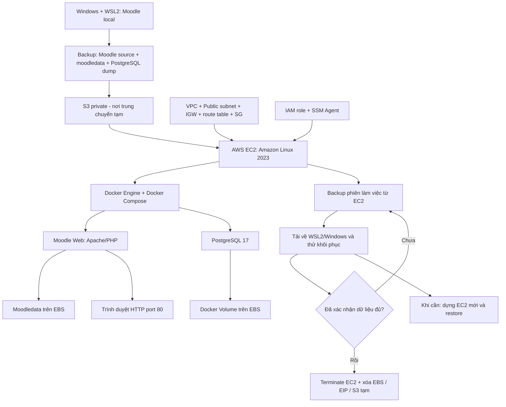
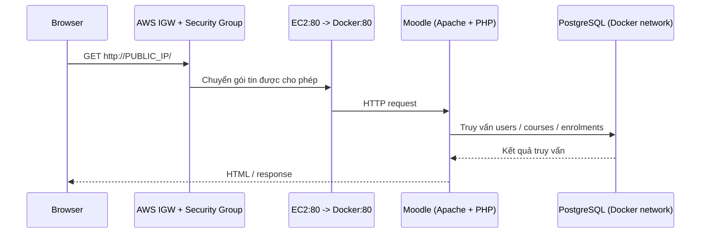

# SmartAttendance · Moodle trên AWS

> **RUNBOOK THỰC HÀNH** · WSL2 → Backup → Amazon S3 → EC2 → Docker → Moodle → Khôi phục / Dọn tài nguyên  
> **Phiên bản:** 1.0 · **Cập nhật:** 24/10/2026 · **Khu vực AWS:** `ap-southeast-1` (Singapore)  
> **Phạm vi:** môi trường **demo/dev** Moodle của đồ án SmartAttendance, **không phải** cấu hình production.

> [!IMPORTANT]
> Tài liệu này tái dựng các bước từ quá trình thực hành đã ghi nhận. Các tên resource và đường dẫn cụ thể bám theo hệ thống của bạn; **ID, mật khẩu, địa chỉ IP hiện hành, kích thước EC2/EBS và nội dung file Compose thực tế phải kiểm tra lại**. Lệnh mẫu không thay thế bước đối chiếu môi trường. **Không xóa EC2, EBS, S3 trước khi có backup đã thử restore.**

## Cách đọc tài liệu

- **Đọc tuần tự** các bước đánh số. Mỗi bước có: **mục tiêu → thao tác/lệnh → giải thích → dấu hiệu thành công**.
- Mục có dấu **▶ Xử lý lỗi** nằm **ngay tại bước phát sinh lỗi**: bấm để mở, bấm lần nữa để thu gọn. Markdown preview của **VS Code** và **GitHub** hỗ trợ `<details>`.
- Các ô `⚠️` là thao tác liên quan dữ liệu/chi phí; **không chạy máy móc**.
- Các phần trong `[... ]` là giá trị cần thay thế; **đừng nhập dấu `< >` của ví dụ vào terminal**.

**Cách xem đẹp nhất:** Mở file trong VS Code → `Ctrl+Shift+V` (**Markdown Preview**); `Ctrl+K V` để xem preview song song với nội dung. Có thể dùng **Outline**, hoặc đẩy file `.md` lên GitHub để đọc và mở/đóng các khối lỗi.

---

## Mục lục

1. [Sơ đồ toàn bộ quy trình](#1-sơ-đồ-toàn-bộ-quy-trình)
2. [Kiến trúc và thông số đã sử dụng](#2-kiến-trúc-và-thông-số-đã-sử-dụng)
3. [Chuẩn bị và kiểm tra Moodle ở WSL2](#3-chuẩn-bị-và-kiểm-tra-moodle-ở-wsl2)
4. [Sao lưu source, PostgreSQL và moodledata ở WSL2](#4-sao-lưu-source-postgresql-và-moodledata-ở-wsl2)
5. [Tạo S3 bucket và chuyển bộ backup](#5-tạo-s3-bucket-và-chuyển-bộ-backup)
6. [Tạo VPC, Subnet, IGW, Route Table, Security Group](#6-tạo-vpc-subnet-igw-route-table-security-group)
7. [Tạo IAM Role, EC2, kết nối SSM](#7-tạo-iam-role-ec2-kết-nối-ssm)
8. [Cài Docker Engine và Docker Compose trên EC2](#8-cài-docker-engine-và-docker-compose-trên-ec2)
9. [Tải dữ liệu từ S3 và giải nén](#9-tải-dữ-liệu-từ-s3-và-giải-nén)
10. [Tạo Compose, .env, PostgreSQL, khôi phục database](#10-tạo-compose-env-postgresql-khôi-phục-database)
11. [Chạy Moodle, kiểm tra URL và quyền moodledata](#11-chạy-moodle-kiểm-tra-url-và-quyền-moodledata)
12. [Tự cập nhật Public IP: Bash, systemd Service/Timer](#12-tự-cập-nhật-public-ip-bash-systemd-servicetimer)
13. [Thêm/cập nhật plugin Moodle](#13-thêmcập-nhật-plugin-moodle)
14. [Vận hành hằng ngày và kiểm tra Stop/Start](#14-vận-hành-hằng-ngày-và-kiểm-tra-stopstart)
15. [BACKUP TỪ EC2 VỀ MÁY: tránh phí EBS lâu dài](#15-backup-từ-ec2-về-máy-tránh-phí-ebs-lâu-dài)
16. [Xóa tài nguyên có phí sau khi đã xác minh backup](#16-xóa-tài-nguyên-có-phí-sau-khi-đã-xác-minh-backup)
17. [Dựng lại EC2 thủ công từ bộ backup](#17-dựng-lại-ec2-thủ-công-từ-bộ-backup)
18. [Bảng lệnh nhanh, checklist, kiến thức Docker](#18-bảng-lệnh-nhanh-checklist-kiến-thức-docker)

---

## 1. Sơ đồ toàn bộ quy trình



> **Phân biệt rất quan trọng:** Quá trình trước đây **không phải** “build Moodle thành Docker Image rồi đẩy Image lên S3”. Ta đã **nén mã nguồn + backup database + moodledata** để chuyển qua S3; trên EC2, Compose sử dụng các Image có sẵn `moodlehq/moodle-php-apache:8.3`, `postgres:17` và **bind mount** source Moodle.

### Luồng request khi sử dụng



---

## 2. Kiến trúc và thông số đã sử dụng

| Thành phần | Thiết kế đang áp dụng | Ý nghĩa |
|---|---|---|
| AWS Region | `ap-southeast-1` | Singapore |
| VPC | `smartattendance-vpc`, `10.20.0.0/16` | Mạng logic riêng |
| Public subnet | `smartattendance-public-subnet`, `10.20.1.0/24` | Đặt EC2 có đường ra IGW |
| Internet Gateway | `smartattendance-igw` | Đường Internet của VPC |
| Route Table | `smartattendance-public-rt` | Có `0.0.0.0/0 → IGW`, **associate với subnet** |
| Security Group | `smartattendance-moodle-sg` | Inbound HTTP `80`, HTTPS `443` chỉ khi sử dụng; **không public** PostgreSQL `5432` |
| IAM Role | `ec2-instance-role` | SSM và quyền đọc S3 tạm thời |
| Host | Amazon Linux 2023 EC2 | Máy chạy Docker |
| Thư mục EC2 | `/opt/smartattendance-moodle` | Toàn bộ project |
| Compose | `compose.yaml` | Quản lý `web`, `db` |
| Moodle image | `moodlehq/moodle-php-apache:8.3` | PHP/Apache cho môi trường demo |
| DB image | `postgres:17` | Database Moodle |
| Web source | `./moodle:/var/www/html` | Bind mount mã nguồn |
| Moodle file storage | `./moodledata:/var/www/moodledata` | Bind mount dữ liệu file |
| PostgreSQL storage | Named volume `postgres_data` | Dữ liệu Postgres độc lập vòng đời container |
| Public endpoint | `http://<PUBLIC_IP>/` | HTTP demo, chưa có domain/HTTPS |
| Đăng nhập EC2 | AWS Systems Manager Session Manager | Không cần SSH inbound `22` |

**Phần chưa làm:** domain, HTTPS, production hardening, backup tự động, Supabase Edge Function gọi Moodle, CI/CD triển khai plugin. **Không dùng tài khoản thật hoặc dữ liệu khuôn mặt trên HTTP công khai.**

---

## 3. Chuẩn bị và kiểm tra Moodle ở WSL2

**Mục tiêu:** xác minh Moodle local sẵn sàng trước khi backup. Các lệnh ở mục này chạy trong **Ubuntu WSL2**, không phải EC2.

### 3.1. Mở WSL2 và vào project

```bash
cd ~/projects/smartattendance-moodle
pwd
ls -la
```

- `cd`: di chuyển đến project.
- `pwd`: in thư mục hiện tại để tránh thao tác sai chỗ.
- `ls -la`: liệt kê mã nguồn, thư mục `backup`, file config và quyền.

### 3.2. Bật Docker Desktop + WSL Integration

Trên Windows mở **Docker Desktop** → Settings → Resources → WSL Integration → bật Ubuntu đang sử dụng. Sau đó chạy:

```bash
docker version
docker ps
```

- `docker version`: kiểm tra CLI giao tiếp được với Docker Engine.
- `docker ps`: kiểm tra container đang chạy.

Trong hệ thống local trước đây dùng `moodle-docker` với web port `8888`, PostgreSQL 17 và PHP 8.3. Nếu shell hiện tại chưa có các biến môi trường, cần gán lại theo project cũ:

```bash
export MOODLE_DOCKER_WWWROOT="$HOME/projects/smartattendance-moodle/moodle"
export MOODLE_DOCKER_DB=pgsql
export MOODLE_DOCKER_PHP_VERSION=8.3
export MOODLE_DOCKER_WEB_PORT=8888
```

**Chú ý:** Biến DB version của dự án gốc và path lệnh `bin/moodle-docker-compose` phụ thuộc thư mục checkout `moodle-docker` mà bạn đã dùng. **Không tự clone/khởi tạo Moodle mới nếu database cũ vẫn còn**; ưu tiên xem `docker ps -a` trước.

<details>
<summary><strong>▶ Xử lý lỗi: <code>docker: command not found</code> trong WSL2</strong></summary>

1. Kiểm tra Docker Desktop đã khởi động trên Windows chưa.
2. Vào Docker Desktop → **Settings → Resources → WSL Integration** và bật đúng distro.
3. Trong PowerShell chạy `wsl --shutdown`, mở lại WSL, rồi `docker version`.
4. Đừng vội cài một Docker daemon thứ hai trong WSL nếu bạn đang dùng Docker Desktop để tránh nhầm context/volume.

</details>

<details>
<summary><strong>▶ Xử lý lỗi: Moodle local không truy cập được <code>localhost:8888</code></strong></summary>

```bash
docker ps -a
docker logs --tail 100 <TEN_CONTAINER_WEB_LOCAL>
```

Kiểm tra đúng container và port publish; nếu đã dùng `moodle-docker`, chạy lại từ thư mục tool của dự án với đúng các biến môi trường: `bin/moodle-docker-compose up -d`. Đừng xóa volume PostgreSQL khi debug.

</details>

**Kiểm tra thành công:** Truy cập được Moodle local ở `http://localhost:8888`, có danh sách khóa học và tài khoản test.

---

## 4. Sao lưu source, PostgreSQL và moodledata ở WSL2

**Mục tiêu:** tạo **ba phần backup độc lập**. Source PHP và moodledata không nằm trong PostgreSQL; ngược lại database cũng không nằm trong source.

### 4.1. Tạo thư mục backup

```bash
cd ~/projects/smartattendance-moodle
mkdir -p backup/aws-migration
```

`mkdir -p` tạo thư mục và thư mục cha nếu chưa có.

### 4.2. Nén mã nguồn Moodle

```bash
tar -czpf backup/aws-migration/moodle-source.tar.gz -C . moodle
```

- `tar`: đóng gói file/thư mục.
- `-c`: tạo archive; `-z`: nén gzip; `-p`: cố gắng bảo toàn quyền; `-f`: chỉ định file output.
- `-C . moodle`: lấy thư mục `moodle` tính từ thư mục dự án hiện tại.
- **Lưu ý:** sẽ bao gồm cả `config.php` nếu nằm trong source; file này có thể có secret, cần lưu an toàn.

### 4.3. Backup PostgreSQL ở Docker local

Lấy tên container trước:

```bash
docker ps --format 'table {{.Names}}\t{{.Image}}\t{{.Status}}'
```

Chạy `pg_dump` với đúng tên container DB. Ví dụ:

```bash
docker exec <TEN_CONTAINER_POSTGRES_LOCAL> \
  pg_dump -U moodle -d moodle -Fc \
  > backup/aws-migration/moodle.dump
```

- `docker exec`: chạy lệnh trong container DB.
- `pg_dump`: tạo **logical backup**, phù hợp để restore trên máy khác.
- `-U moodle`: user PostgreSQL; `-d moodle`: tên DB.
- `-Fc`: dạng custom archive, có thể kiểm tra và restore bằng `pg_restore`.
- `>`: lưu stdout ra file trên WSL2.

Xác minh:

```bash
ls -lh backup/aws-migration/moodle.dump
docker run --rm -i postgres:17 pg_restore -l \
  < backup/aws-migration/moodle.dump | head
```

**Ghi chú:** `docker run --rm -i postgres:17 ...` khởi tạo container tạm chỉ để đọc định dạng archive; không đụng tới database đang chạy. Hoặc dùng `pg_restore -l` nếu WSL2 đã có `postgresql-client`.

### 4.4. Nén moodledata

Nếu moodledata nằm trong container web ở `/var/www/moodledata`:

```bash
docker cp <TEN_CONTAINER_WEB_LOCAL>:/var/www/moodledata \
  backup/aws-migration/moodledata

tar -czpf backup/aws-migration/moodledata.tar.gz \
  -C backup/aws-migration moodledata
```

- `docker cp`: sao chép thư mục từ container ra host.
- `tar`: tạo archive để upload dễ hơn.

### 4.5. Xem dung lượng và checksum

```bash
cd ~/projects/smartattendance-moodle/backup/aws-migration
ls -lh *.tar.gz *.dump
sha256sum moodle-source.tar.gz moodledata.tar.gz moodle.dump \
  > SHA256SUMS.txt
sha256sum -c SHA256SUMS.txt
```

`sha256sum` dùng để phát hiện file lỗi hoặc thay đổi trong quá trình truyền tải.

<details>
<summary><strong>▶ Xử lý lỗi: <code>pg_dump</code> lỗi user/password hoặc tên database</strong></summary>

```bash
docker ps
# Kiểm tra env DB (CẨN THẬN: có thể chứa thông tin nhạy cảm)
docker exec <TEN_CONTAINER_POSTGRES_LOCAL> sh -c \
  'printf "DB=%s USER=%s\n" "$POSTGRES_DB" "$POSTGRES_USER"'
```

Sử dụng đúng DB name, DB user của container thật. **Không gửi mật khẩu lên chat, issue hay Git.** Tránh dump nóng bằng cách copy trực tiếp thư mục Postgres đang chạy.

</details>

<details>
<summary><strong>▶ Xử lý lỗi: <code>Permission denied</code> khi <code>docker cp</code> / <code>tar</code></strong></summary>

Dùng đường dẫn có quyền ghi và kiểm tra sở hữu file:

```bash
ls -ld backup backup/aws-migration
ls -ld backup/aws-migration/moodledata
```

Nếu cần, chỉnh quyền đúng thư mục backup của mình; **không chạy `chmod -R 777` lên toàn bộ Moodle**.

</details>

**Hoàn thành khi:** có `moodle-source.tar.gz`, `moodledata.tar.gz`, `moodle.dump`, `SHA256SUMS.txt`, và checksum đều `OK`.

---

## 5. Tạo S3 bucket và chuyển bộ backup

**Mục tiêu:** dùng S3 **làm trung chuyển tạm**, EC2 được phép tải file. Không cần giữ S3 mãi nếu backup đã về local và đã xác minh.

### 5.1. Tạo bucket qua AWS Console

1. Mở **S3 → Create bucket**.
2. Chọn Region **Singapore** `ap-southeast-1`.
3. Đặt tên globally unique, ví dụ bucket đã dùng: `smartattendance-moodle-transfer-2026` (**kiểm tra còn tồn tại và thuộc tài khoản mình**).
4. Giữ **Block all public access** bật.
5. Mặc định server-side encryption S3 được bật; không đưa secret ra public.

### 5.2. Upload bằng AWS CLI trên WSL2

```bash
aws sts get-caller-identity
aws s3 cp moodle-source.tar.gz \
  s3://smartattendance-moodle-transfer-2026/aws-migration/moodle-source.tar.gz
aws s3 cp moodledata.tar.gz \
  s3://smartattendance-moodle-transfer-2026/aws-migration/moodledata.tar.gz
aws s3 cp moodle.dump \
  s3://smartattendance-moodle-transfer-2026/aws-migration/moodle.dump
aws s3 cp SHA256SUMS.txt \
  s3://smartattendance-moodle-transfer-2026/aws-migration/SHA256SUMS.txt
```

- `aws sts get-caller-identity`: kiểm tra CLI đang dùng tài khoản AWS nào.
- `aws s3 cp`: upload từng object.
- Nếu CLI chưa cài/chưa cấu hình, có thể upload bằng giao diện S3 Console; không nhúng AWS Access Key trong tài liệu hoặc shell script.

Kiểm tra:

```bash
aws s3 ls s3://smartattendance-moodle-transfer-2026/aws-migration/
```

<details>
<summary><strong>▶ Xử lý lỗi: <code>AccessDenied</code> hoặc <code>Unable to locate credentials</code></strong></summary>

- Kiểm tra `aws sts get-caller-identity` và profile/Region đang dùng.
- User/Role upload cần quyền S3 phù hợp cho bucket, ví dụ `s3:PutObject` trên prefix đang upload.
- Quyền EC2 tải từ bucket **khác với quyền người dùng WSL2 upload**.
- Không đặt bucket thành public chỉ để né lỗi IAM.

</details>

**Hoàn thành khi:** thấy đủ 4 object ở S3.

---

## 6. Tạo VPC, Subnet, IGW, Route Table, Security Group

**Mục tiêu:** EC2 có mạng public để người dùng truy cập HTTP và SSM Agent kết nối dịch vụ AWS. Phần này nên thao tác bằng **AWS Console** vì bạn muốn nắm từng thành phần.

### 6.1. Tạo VPC

**VPC → Your VPCs → Create VPC**:

- Name: `smartattendance-vpc`
- IPv4 CIDR: `10.20.0.0/16`
- VPC only; không vô tình bật NAT Gateway có phí.

**Giải thích:** VPC tạo vùng mạng riêng. CIDR `/16` là phạm vi IP private nội bộ, **không phải Public IP**.

### 6.2. Tạo Public Subnet

**VPC → Subnets → Create subnet**:

- VPC: `smartattendance-vpc`
- Name: `smartattendance-public-subnet`
- AZ: `ap-southeast-1a` (hoặc AZ khả dụng đúng Region)
- IPv4 CIDR: `10.20.1.0/24`
- Bật **Auto-assign public IPv4** nếu bạn muốn EC2 mới nhận Public IP tự động (xem thêm chính sách IP và phí).

### 6.3. Tạo Internet Gateway

**VPC → Internet Gateways → Create** tên `smartattendance-igw` → **Attach** vào `smartattendance-vpc`.

**Giải thích:** IGW là thành phần kết nối Internet của VPC; tạo IGW thôi **chưa đủ** nếu Route Table không trỏ đến nó.

### 6.4. Tạo Route Table, tuyến mặc định, associate Subnet

**VPC → Route tables → Create** tên `smartattendance-public-rt` trong VPC mới.

Thêm route:

| Destination | Target |
|---|---|
| `10.20.0.0/16` | `local` (AWS tự có) |
| `0.0.0.0/0` | `smartattendance-igw` |

**Cực kỳ quan trọng:** tab **Subnet associations → Edit subnet associations → chọn `smartattendance-public-subnet` → Save**.

Lỗi SSM trước đây của bạn liên quan đến khả năng outbound TCP 443; một vấn đề đã được xử lý trong quá trình tạo VPC mới là liên kết Route Table đúng với Public Subnet.

### 6.5. Tạo Security Group

**EC2 → Security Groups → Create** `smartattendance-moodle-sg` trong VPC mới:

| Direction | Protocol | Port | Source |
|---|---|---:|---|
| Inbound | TCP | 80 | IP của người thử nghiệm, hoặc `0.0.0.0/0` **chỉ trong demo HTTP công khai** |
| Inbound | TCP | 443 | Chỉ bật khi có HTTPS thực sự |
| Inbound | TCP | 22 | **Không mở** (dùng SSM) |
| Inbound | TCP | 5432 | **Không mở** |
| Outbound | TCP | 443 | Cho phép tới các endpoint cần thiết; cấu hình đơn giản ban đầu có thể để outbound mặc định |

**Giải thích:** Security Group là stateful firewall. Mở cổng 80 không đồng nghĩa Moodle đã có HTTPS.

<details>
<summary><strong>▶ Xử lý lỗi: EC2 không có Internet hoặc SSM timeout</strong></summary>

Kiểm tra lần lượt: (1) EC2 thuộc đúng VPC/subnet; (2) subnet đã associate Route Table chứa `0.0.0.0/0 → IGW`; (3) EC2 có Public IPv4; (4) outbound SG cho phép HTTPS 443; (5) IAM Role đã gắn; (6) trạng thái SSM Agent. Không kết luận ngay là lỗi IAM khi log báo `i/o timeout`.

</details>

**Hoàn thành khi:** VPC, Subnet, IGW, Route Table/association, SG có cấu hình như bảng.

---

## 7. Tạo IAM Role, EC2, kết nối SSM

### 7.1. IAM Role cho EC2

**IAM → Roles → Create role**:

1. Trusted entity type: **AWS service**.
2. Use case: **EC2**.
3. Attach managed policy: `AmazonSSMManagedInstanceCore`.
4. Name: `ec2-instance-role`.
5. Để EC2 tải file từ S3, thêm **policy hẹp** với `s3:ListBucket` cho bucket và `s3:GetObject` cho các object trong prefix `aws-migration/`. Tránh cấp `AmazonS3FullAccess` không cần thiết.

Ví dụ policy, thay bucket nếu khác:

```json
{
  "Version": "2012-10-17",
  "Statement": [
    {"Effect":"Allow","Action":["s3:ListBucket"],"Resource":"arn:aws:s3:::smartattendance-moodle-transfer-2026"},
    {"Effect":"Allow","Action":["s3:GetObject"],"Resource":"arn:aws:s3:::smartattendance-moodle-transfer-2026/aws-migration/*"}
  ]
}
```

**Giải thích:** IAM kiểm soát API AWS mà EC2 được phép gọi; SG kiểm soát đường mạng — hai thứ khác nhau.

### 7.2. Tạo EC2

**EC2 → Instances → Launch instance**:

- Name: `smartattendance-moodle-ec2` (tên mô tả; kiểm tra tên resource thật của bạn).
- AMI: **Amazon Linux 2023**, kiến trúc x86_64.
- Instance type: chọn theo khả năng chi phí/vCPU quota và RAM; trước đây đã sử dụng dòng `t3` (không mặc định đoán kích cỡ chính xác).
- VPC/Subnet: VPC + public subnet đã tạo.
- Auto-assign Public IP: enabled nếu muốn public IP tạm.
- Security Group: `smartattendance-moodle-sg`.
- Advanced details → IAM instance profile: `ec2-instance-role`.
- Root EBS: chọn dung lượng đủ dùng; **kiểm tra `Delete on termination`** để biết khi xóa EC2 volume có bị xóa không.

> [!WARNING]
> Tạo EC2 public IPv4 và EBS có thể phát sinh phí ngay. Không tạo NAT Gateway hoặc Load Balancer nếu đồ án chưa cần.

### 7.3. Kết nối không cần SSH

**EC2 → Instances → chọn EC2 → Connect → Session Manager → Connect**.

Trên shell EC2:

```bash
whoami
uname -a
cat /etc/os-release
curl -I https://aws.amazon.com
```

- `whoami`: user hiện tại (`ssm-user`/shell tương ứng).
- `uname -a`: kernel/kiến trúc.
- `/etc/os-release`: kiểm tra đúng Amazon Linux.
- `curl -I`: kiểm tra outbound HTTPS (chỉ headers).

<details>
<summary><strong>▶ Xử lý lỗi: SSM Agent không online / <code>i/o timeout</code></strong></summary>

1. Xác minh IAM instance profile có `AmazonSSMManagedInstanceCore`.
2. Kiểm tra public IP, route đến Internet Gateway và outbound 443.
3. Nếu không có public route thì cần thiết kế NAT hoặc VPC endpoints cho SSM/ssmmessages/ec2messages (tùy môi trường), không phải mở inbound SSH.
4. Nếu vào EC2 bằng phương thức khác được: `sudo systemctl status amazon-ssm-agent`.
5. VPC cũ đã từng lỗi liên kết định tuyến; kiểm tra lại **Subnet association** trước.

</details>

**Hoàn thành khi:** dùng được Session Manager, không cần mở port 22.

---

## 8. Cài Docker Engine và Docker Compose trên EC2

**Các lệnh sau chạy trong Session Manager của EC2.**

### 8.1. Cài Docker và khởi động tự động

```bash
sudo dnf update -y
sudo dnf install -y docker
sudo systemctl enable --now docker
sudo docker version
sudo docker ps
```

- `dnf update`: cập nhật package metadata và các package đã cài.
- `dnf install docker`: cài Docker Engine.
- `systemctl enable --now docker`: bật Docker **ngay bây giờ** và khi boot.
- `docker version`/`docker ps`: xác nhận daemon hoạt động.

### 8.2. Cài Docker Compose v2 plugin

Thử từ package manager trước:

```bash
sudo dnf install -y docker-compose-plugin
sudo docker compose version
```

Nếu báo package không tồn tại (đã xảy ra với môi trường thực hành trước đây), cài CLI plugin bằng binary:

1. Mở trang release chính thức: https://github.com/docker/compose/releases
2. Chọn một bản stable tương thích kiến trúc `uname -m` (`x86_64` cho EC2 x86_64).
3. Trong ví dụ dưới, **thay phiên bản `vX.Y.Z` bằng tag stable mà bạn vừa xác minh trên GitHub**:

```bash
uname -m
COMPOSE_VERSION='vX.Y.Z'  # PHẢI THAY bằng phiên bản thật
sudo mkdir -p /usr/local/lib/docker/cli-plugins
sudo curl -fL \
  "https://github.com/docker/compose/releases/download/${COMPOSE_VERSION}/docker-compose-linux-x86_64" \
  -o /usr/local/lib/docker/cli-plugins/docker-compose
sudo chmod +x /usr/local/lib/docker/cli-plugins/docker-compose
sudo docker compose version
```

**Giải thích:** Compose v2 là CLI plugin. `sudo docker compose` (có khoảng trắng) khác binary cũ `docker-compose` (có dấu gạch nối). Nên kiểm tra checksum/signature theo bản release nếu dùng lâu dài.

<details>
<summary><strong>▶ Xử lý lỗi: <code>docker: 'compose' is not a docker command</code></strong></summary>

Kiểm tra vị trí plugin:

```bash
sudo ls -la /usr/local/lib/docker/cli-plugins/
sudo docker compose version
```

Trước đây có lần tạo nhầm thư mục `cli-plugins~` (thừa dấu `~`). **Đường dẫn chính xác**: `/usr/local/lib/docker/cli-plugins/docker-compose`. Kiểm tra kiến trúc EC2 và quyền execute.

</details>

<details>
<summary><strong>▶ Xử lý lỗi: <code>permission denied</code> khi chạy docker</strong></summary>

Dùng `sudo docker ...` cho các bước trên EC2. Có thể thêm user vào nhóm docker, nhưng nhóm này mang quyền gần như root; với SSM quản trị demo, ưu tiên `sudo`.

</details>

**Hoàn thành khi:** `sudo docker version` và `sudo docker compose version` đều thành công.

---

## 9. Tải dữ liệu từ S3 và giải nén

### 9.1. Tạo thư mục trên EC2

```bash
sudo mkdir -p /opt/smartattendance-moodle/{transfer,postgres-backup,moodledata}
cd /opt/smartattendance-moodle
```

`/opt` là nơi phù hợp cho phần mềm tự triển khai; `transfer` chứa file tạm.

### 9.2. Tải backup từ S3

```bash
aws sts get-caller-identity
aws s3 cp s3://smartattendance-moodle-transfer-2026/aws-migration/ \
  /opt/smartattendance-moodle/transfer/ --recursive
```

- `sts`: chứng minh EC2 nhận IAM Role chính xác.
- `s3 cp --recursive`: tải tất cả file trong prefix.
- Nếu SSM user không có quyền ghi thư mục `/opt`, dùng thư mục home làm trung gian rồi `sudo mv`; **đừng chuyển IAM key cho root**.

Kiểm tra:

```bash
cd /opt/smartattendance-moodle/transfer
ls -lh
sha256sum -c SHA256SUMS.txt
```

### 9.3. Giải nén source và moodledata

```bash
cd /opt/smartattendance-moodle
sudo tar -xzpf transfer/moodle-source.tar.gz -C .
sudo tar -xzpf transfer/moodledata.tar.gz -C .
sudo cp transfer/moodle.dump postgres-backup/moodle.dump
sudo ls -la moodle/config.php moodle/public
```

`tar -x` giải nén; `-C .` chỉ nơi giải nén. Hai archive được tạo với thư mục gốc `moodle/`, `moodledata/` như mục 4.

<details>
<summary><strong>▶ Xử lý lỗi: <code>AccessDenied</code> khi EC2 đọc S3</strong></summary>

- Xem IAM Role đang gắn EC2.
- Kiểm tra bucket/prefix đúng (`aws-migration/`).
- Cho role `s3:GetObject` trên ARN object, `s3:ListBucket` trên bucket.
- Kiểm tra bucket policy/KMS nếu có dùng khóa mã hóa riêng.

</details>

<details>
<summary><strong>▶ Xử lý lỗi: <code>Permission denied</code> tại <code>/opt</code></strong></summary>

Ví dụ an toàn:

```bash
mkdir -p "$HOME/moodle-transfer"
aws s3 cp s3://smartattendance-moodle-transfer-2026/aws-migration/ \
  "$HOME/moodle-transfer/" --recursive
sudo mkdir -p /opt/smartattendance-moodle/transfer
sudo cp -a "$HOME/moodle-transfer/." /opt/smartattendance-moodle/transfer/
```

</details>

**Hoàn thành khi:** source, moodledata và `postgres-backup/moodle.dump` tồn tại trên EC2.

---

## 10. Tạo Compose, .env, PostgreSQL, khôi phục database

### 10.1. Tạo `.env` an toàn

```bash
cd /opt/smartattendance-moodle
sudo sh -c 'umask 077; touch .env; chmod 600 .env'
openssl rand -hex 24
```

`openssl rand -hex 24` in ra password ngẫu nhiên. Dùng giá trị đó **chỉ trong `.env` riêng của EC2**, ví dụ:

```dotenv
POSTGRES_DB=moodle
POSTGRES_USER=moodle
POSTGRES_PASSWORD=PASTE_RANDOM_PASSWORD_HERE
MOODLE_PUBLIC_IP=YOUR_CURRENT_EC2_PUBLIC_IP
```

**Không commit `.env`, không để mật khẩu thật trong hướng dẫn hoặc chat.** Nếu bạn đang **khôi phục từ bản backup EC2 cũ**, có thể dùng file `.env` đã sao lưu bảo mật thay vì tự đặt mật khẩu mới (cần tương thích với Postgres volume cũ nếu đang tái sử dụng volume).

### 10.2. Tạo Compose

```bash
cd /opt/smartattendance-moodle
sudo nano compose.yaml
```

Cấu hình mẫu khớp kiến trúc Moodle demo đã sử dụng:

```yaml
services:
  db:
    image: postgres:17
    container_name: smartattendance-postgres
    restart: unless-stopped
    environment:
      POSTGRES_DB: ${POSTGRES_DB}
      POSTGRES_USER: ${POSTGRES_USER}
      POSTGRES_PASSWORD: ${POSTGRES_PASSWORD}
    volumes:
      - postgres_data:/var/lib/postgresql/data
    healthcheck:
      test: ["CMD-SHELL", "pg_isready -U $$POSTGRES_USER -d $$POSTGRES_DB"]
      interval: 10s
      timeout: 5s
      retries: 10

  web:
    image: moodlehq/moodle-php-apache:8.3
    container_name: smartattendance-moodle-web
    restart: unless-stopped
    depends_on:
      db:
        condition: service_healthy
    ports:
      - "80:80"
    volumes:
      - ./moodle:/var/www/html
      - ./moodledata:/var/www/moodledata
    environment:
      MOODLE_DOCKER_RUNNING: "1"
      MOODLE_DOCKER_DBTYPE: pgsql
      MOODLE_DOCKER_DBNAME: ${POSTGRES_DB}
      MOODLE_DOCKER_DBUSER: ${POSTGRES_USER}
      MOODLE_DOCKER_DBPASS: ${POSTGRES_PASSWORD}
      MOODLE_DOCKER_WEB_HOST: ${MOODLE_PUBLIC_IP:-localhost}

volumes:
  postgres_data:
```

**Giải thích:**

- `db`: tạo Postgres 17, không publish port `5432`.
- `web`: chạy PHP/Apache, publish port `80` ra EC2.
- `./moodle` và `./moodledata`: bind mount dữ liệu thực từ EC2.
- `postgres_data`: named volume dùng để lưu database qua lần recreate.
- `depends_on.condition: service_healthy`: chờ DB đủ sẵn sàng trước khi chạy web.
- `$$POSTGRES_USER`: hai dấu `$` yêu cầu Compose chuyển biến cho shell bên trong container, thay vì interpolate ở host.

> **Giới hạn:** `moodlehq/moodle-php-apache:8.3` từ bộ công cụ phát triển Moodle. Dùng cho demo, chưa phải cấu hình production hardened. Trước khi áp dụng mẫu này, đối chiếu các biến `MOODLE_DOCKER_*` với `moodle/config.php` thực tế đã backup.

### 10.3. Kiểm tra và chạy riêng database

```bash
cd /opt/smartattendance-moodle
sudo docker compose config --quiet
sudo docker compose up -d db
sudo docker compose ps
sudo docker compose logs --tail=50 db
```

**Giải thích:** `config --quiet` kiểm tra YAML; `up -d db` chạy riêng DB dưới nền; `logs` kiểm tra khởi tạo.

### 10.4. Restore PostgreSQL từ `.dump`

**Chỉ thực hiện trên database mới hoặc DB bạn chủ động muốn thay thế.**

```bash
cd /opt/smartattendance-moodle
sudo docker exec -i smartattendance-postgres sh -c \
  'exec pg_restore -U "$POSTGRES_USER" -d "$POSTGRES_DB" \
   --no-owner --no-privileges --single-transaction --exit-on-error' \
  < postgres-backup/moodle.dump
```

- `docker exec -i`: đọc dữ liệu dump từ stdin.
- `pg_restore`: nạp custom archive vào PostgreSQL.
- `--no-owner --no-privileges`: tránh xung đột owner/GRANT cũ.
- `--single-transaction`: toàn bộ restore trong một transaction.
- `--exit-on-error`: dừng nếu lỗi (không che lỗi).

**Quan trọng:** Trên database đã có bảng, lệnh trên có thể bị `relation already exists`; không được chạy lại tùy tiện. Nếu cần restore lại, hãy làm trên **DB rỗng mới** và chỉ dùng `--clean` khi hiểu rõ dữ liệu nào bị xóa.

### 10.5. Kiểm tra database

```bash
sudo docker exec smartattendance-postgres sh -c \
  'psql -U "$POSTGRES_USER" -d "$POSTGRES_DB" -c "SELECT count(*) FROM mdl_user;"'
```

Nếu prefix của bảng trong Moodle không phải `mdl_`, hãy kiểm tra `config.php` trước.

<details>
<summary><strong>▶ Xử lý lỗi: <code>pg_restore: relation already exists</code></strong></summary>

Nghĩa là database **không rỗng** hoặc đã restore một phần. Đừng xóa ngay. Kiểm tra `\dt`, dung lượng và nguồn backup. Phương án an toàn: tạo **DB/container/volume mới** để thử restore, rồi đối chiếu dữ liệu trước khi thay dữ liệu cũ.

</details>

<details>
<summary><strong>▶ Xử lý lỗi: PostgreSQL không healthy</strong></summary>

```bash
sudo docker compose logs --tail=100 db
sudo docker inspect smartattendance-postgres \
  --format '{{json .State.Health}}'
```

Kiểm tra `POSTGRES_DB`, `POSTGRES_USER`, quyền volume và dung lượng ổ đĩa. Nếu volume đã khởi tạo bằng password cũ thì chỉ đổi `.env` **không tự đổi password của PostgreSQL đã tồn tại**.

</details>

**Hoàn thành khi:** DB healthy và truy vấn user/course có dữ liệu.

---

## 11. Chạy Moodle, kiểm tra URL và quyền moodledata

### 11.1. Kiểm tra `config.php` trước khi bật web

```bash
cd /opt/smartattendance-moodle
grep -nE 'MOODLE_DOCKER_WEB_HOST|CFG->wwwroot|CFG->dataroot|HTTP_HOST' moodle/config.php
```

`grep -nE` in các dòng cấu hình liên quan; tránh in nguyên `config.php` vì có thể chứa secrets.

Cấu hình Moodle trước đây có dạng:

```php
if (!empty(getenv('MOODLE_DOCKER_WEB_HOST'))) {
    $host = getenv('MOODLE_DOCKER_WEB_HOST');
}
$CFG->wwwroot = "http://{$host}";
```

Moodle cần `$CFG->wwwroot` là URL hợp lệ **từ cấu hình tin cậy**, không lấy trực tiếp một HTTP Host header bất kỳ để quyết định domain chính thức.

### 11.2. Chạy web

```bash
cd /opt/smartattendance-moodle
sudo docker compose up -d web
sudo docker compose ps
sudo docker compose logs --tail=100 web
```

### 11.3. Kiểm tra HTTP không tự động follow redirect

```bash
curl -I http://127.0.0.1/
```

Xem `HTTP/1.1 200` hoặc `303 Location: http://<PUBLIC_IP>/`. `curl -I` chỉ lấy headers; dùng nó để phát hiện redirect sai.

<details>
<summary><strong>▶ Xử lý lỗi: <code>$CFG->dataroot is not writable</code></strong></summary>

**Nguyên nhân:** Apache/PHP trong container không có quyền ghi thư mục bind mount `moodledata`.

```bash
sudo docker exec smartattendance-moodle-web id www-data
sudo ls -ld /opt/smartattendance-moodle/moodledata
sudo docker exec smartattendance-moodle-web sh -c \
  'ls -ld /var/www/moodledata; id www-data'
```

Nếu container dùng `www-data` với UID/GID `33:33` (phải kiểm tra kết quả thực tế), cân nhắc:

```bash
sudo chown -R 33:33 /opt/smartattendance-moodle/moodledata
sudo find /opt/smartattendance-moodle/moodledata -type d -exec chmod 750 {} +
sudo find /opt/smartattendance-moodle/moodledata -type f -exec chmod 640 {} +
```

Lưu ý Moodledata **không được đặt trong web public root**. Không `chmod -R 777`.

</details>

<details>
<summary><strong>▶ Xử lý lỗi: Truy cập Public IP nhưng trình duyệt hiện IIS / redirect <code>localhost</code></strong></summary>

Lỗi thực tế đã gặp: Moodle trả `303 Location: http://localhost/`. Browser trên Windows chuyển hướng về `localhost` của **Windows** (có IIS), không phải về EC2.

1. Kiểm tra:

```bash
curl -I http://127.0.0.1/
grep '^MOODLE_PUBLIC_IP=' .env
sudo docker compose config | grep MOODLE_DOCKER_WEB_HOST
```

2. Nếu `MOODLE_DOCKER_WEB_HOST` chưa đúng, sửa `.env` với IP mới và đảm bảo không có `$CFG->wwwroot` cố định ghi đè.
3. Áp dụng biến môi trường bằng **recreate** container web:

```bash
sudo docker compose up -d --no-deps --force-recreate web
```

> `docker compose restart web` **không** nạp biến môi trường đã đổi trong Compose/.env; cần recreate.

</details>

<details>
<summary><strong>▶ Xử lý lỗi: Docker đang chạy nhưng Public IP không truy cập được</strong></summary>

Kiểm tra từng lớp: `docker compose ps` → `curl -I 127.0.0.1` trên EC2 → Security Group inbound `80` → subnet route `0.0.0.0/0 → IGW` → EC2 có Public IPv4 → URL `wwwroot`. Đừng mở cổng PostgreSQL để sửa lỗi HTTP.

</details>

**Hoàn thành khi:** trình duyệt từ máy ngoài EC2 mở được Moodle qua `http://<PUBLIC_IP>/`, không tự chuyển về localhost.

---

## 12. Tự cập nhật Public IP: Bash, systemd Service/Timer

**Mục tiêu:** tự thay `MOODLE_PUBLIC_IP` khi AWS đổi Public IP, chỉ recreate web nếu thực sự khác. Đã thử Stop/Start EC2 và Moodle vẫn truy cập được; **để xác nhận tự đổi IP hoạt động, cần log chứng minh IP cũ và mới khác nhau**.

### 12.1. Kiểm tra IMDSv2 trên EC2

```bash
TOKEN=$(curl -fsS -X PUT \
  http://169.254.169.254/latest/api/token \
  -H 'X-aws-ec2-metadata-token-ttl-seconds: 60')
PUBLIC_IP=$(curl -fsS \
  -H "X-aws-ec2-metadata-token: $TOKEN" \
  http://169.254.169.254/latest/meta-data/public-ipv4)
echo "$PUBLIC_IP"
```

- IMDSv2 là metadata service **nội bộ của EC2**, không phải API public.
- Token PUT giúp hạn chế truy cập metadata không có token.
- Output là Public IPv4 **hiện tại**, không hardcode IP cũ.

### 12.2. Script cập nhật IP

Đường dẫn: `/usr/local/bin/update-moodle-ip.sh`. Phiên bản có kiểm tra IPv4, khóa chạy song song, kiểm tra Compose, sao lưu `.env` trước khi đổi và chỉ recreate web khi cần:

```bash
sudo nano /usr/local/bin/update-moodle-ip.sh
```

```bash
#!/usr/bin/env bash
set -euo pipefail
exec 9>/run/update-moodle-ip.lock
flock -n 9 || exit 0

ROOT=/opt/smartattendance-moodle
ENVFILE="$ROOT/.env"
cd "$ROOT"

TOKEN=$(curl -fsS --retry 3 --connect-timeout 2 --max-time 8 \
  -X PUT http://169.254.169.254/latest/api/token \
  -H 'X-aws-ec2-metadata-token-ttl-seconds: 60')
IP=$(curl -fsS --retry 3 --connect-timeout 2 --max-time 8 \
  -H "X-aws-ec2-metadata-token: $TOKEN" \
  http://169.254.169.254/latest/meta-data/public-ipv4)

python3 - "$IP" <<'PY'
import ipaddress, sys
v = ipaddress.ip_address(sys.argv[1])
if v.version != 4 or not v.is_global:
    raise SystemExit('Not a valid public IPv4')
PY

[ -f "$ENVFILE" ] || { echo 'Missing .env' >&2; exit 1; }
OLD=$(sed -n 's/^MOODLE_PUBLIC_IP=//p' "$ENVFILE" | tail -1)
if [ "$OLD" = "$IP" ]; then
  echo "IP unchanged: $IP"
  exit 0
fi

cp -p "$ENVFILE" "$ENVFILE.bak"
if grep -q '^MOODLE_PUBLIC_IP=' "$ENVFILE"; then
  sed -i "s/^MOODLE_PUBLIC_IP=.*/MOODLE_PUBLIC_IP=$IP/" "$ENVFILE"
else
  printf '\nMOODLE_PUBLIC_IP=%s\n' "$IP" >> "$ENVFILE"
fi
chmod 600 "$ENVFILE"

docker compose config --quiet || {
  cp -p "$ENVFILE.bak" "$ENVFILE"
  exit 1
}
if ! docker compose up -d --no-deps --force-recreate web; then
  cp -p "$ENVFILE.bak" "$ENVFILE"
  echo 'Recreate failed; restored .env; inspect web state' >&2
  exit 1
fi
rm -f "$ENVFILE.bak"
echo "Moodle host IP changed: ${OLD:-unset} -> $IP"
```

**Giải thích:** `flock` tránh hai lần chạy đồng thời; `ipaddress` chặn IP không hợp lệ; `sed` sửa một biến; Compose kiểm tra YAML rồi recreate riêng `web` (không xóa PostgreSQL Volume).

> Để giảm biến chứng khi đổi IP, **nên chuyển sang domain/HTTPS cố định khi tích hợp Supabase**. Cơ chế IP tự đổi là giải pháp demo, không phải thiết kế URL lâu dài.

```bash
sudo chown root:root /usr/local/bin/update-moodle-ip.sh
sudo chmod 750 /usr/local/bin/update-moodle-ip.sh
sudo bash -n /usr/local/bin/update-moodle-ip.sh
sudo /usr/local/bin/update-moodle-ip.sh
```

### 12.3. systemd Service — chạy lúc boot

```bash
sudo nano /etc/systemd/system/update-moodle-ip.service
```

```ini
[Unit]
Description=Update SmartAttendance Moodle public IP
Wants=network-online.target
After=network-online.target docker.service
Requires=docker.service

[Service]
Type=oneshot
User=root
WorkingDirectory=/opt/smartattendance-moodle
ExecStart=/usr/local/bin/update-moodle-ip.sh
TimeoutStartSec=120

[Install]
WantedBy=multi-user.target
```

```bash
sudo systemctl daemon-reload
sudo systemctl enable update-moodle-ip.service
sudo systemctl start update-moodle-ip.service
sudo systemctl status update-moodle-ip.service --no-pager
```

`oneshot`: chạy xong thoát; `inactive (dead)` với `status=0/SUCCESS` **có thể là bình thường**, không phải failure.

### 12.4. systemd Timer — kiểm tra khi đang chạy

```bash
sudo nano /etc/systemd/system/update-moodle-ip.timer
```

```ini
[Unit]
Description=Periodically check Moodle EC2 public IPv4

[Timer]
OnBootSec=2min
OnUnitInactiveSec=1min
Unit=update-moodle-ip.service
AccuracySec=10s

[Install]
WantedBy=timers.target
```

```bash
sudo systemctl daemon-reload
sudo systemctl enable --now update-moodle-ip.timer
sudo systemctl status update-moodle-ip.timer --no-pager
systemctl list-timers --all | grep update-moodle-ip
sudo journalctl -u update-moodle-ip.service -n 30 --no-pager
```

<details>
<summary><strong>▶ Xử lý lỗi: Script chạy nhưng không đổi URL Moodle</strong></summary>

```bash
grep '^MOODLE_PUBLIC_IP=' /opt/smartattendance-moodle/.env
cd /opt/smartattendance-moodle
sudo docker compose config | grep MOODLE_DOCKER_WEB_HOST
grep -n 'CFG->wwwroot' moodle/config.php
curl -sI http://127.0.0.1/ | grep -iE 'HTTP/|Location:'
```

Nếu `.env` đổi rồi nhưng container chưa dùng biến mới, recreate web. Nếu `config.php` ghi đè `wwwroot`, sửa nhánh cấu hình phù hợp. Nếu IP **không đổi** mà container **không chạy**, script chỉ so sánh IP sẽ không tự khởi động web; kiểm tra Docker restart policy và dùng `docker compose up -d` khi cần.

</details>

<details>
<summary><strong>▶ Xử lý lỗi: Service fail ngay sau boot nhưng chạy thủ công thành công</strong></summary>

```bash
sudo journalctl -b -u update-moodle-ip.service --no-pager
sudo systemctl status docker --no-pager
```

Có thể IMDS/network chưa sẵn sàng đúng lúc. Timer sẽ chạy lại; tăng retry/backoff nếu thường xuyên gặp lỗi. Không tắt kiểm tra lỗi chỉ để Service hiển thị xanh.

</details>

**Hoàn thành khi:** service enabled, timer active, log không báo lỗi; nếu muốn chứng minh **auto-rotate IP**, phải xác minh IP thay đổi trên lần thử thực tế.

---

## 13. Thêm/cập nhật plugin Moodle

**Mục tiêu:** mở rộng Moodle, không cần sửa Moodle Core. Phạm vi SmartAttendance đã chọn:

- `local_smartidentity`: trang Admin quản lý ánh xạ Moodle/Supabase, phê duyệt/khóa Face Enrollment.
- `mod_smartattendance`: Activity trong Course để giảng viên xem session, QR, attendance, báo cáo/Gradebook.

### 13.1. Đặt plugin đúng thư mục

Nếu Moodle source trên EC2 có `public/`:

```text
/opt/smartattendance-moodle/moodle/public/local/smartidentity/
/opt/smartattendance-moodle/moodle/public/mod/smartattendance/
```

Plugin `local_smartidentity` phải có `version.php` khai báo component tương ứng:

```php
<?php
defined('MOODLE_INTERNAL') || die();
$plugin->component = 'local_smartidentity';
$plugin->version = 2026102400;
// $plugin->requires = <phiên bản Moodle tối thiểu đúng với bản đang dùng>;
```

**Không dùng nguyên file minh họa để cài đặt:** phải khai báo `$plugin->requires` phù hợp Moodle hiện tại và bổ sung các file API/bảo mật theo tài liệu phiên bản tương ứng.

### 13.2. Truyền plugin từ WSL2 sang EC2

Nên phát triển/kiểm thử plugin trên WSL2 → commit Git → đóng gói và triển khai. Với bản demo, có thể tạo archive thư mục plugin, upload S3 tạm, tải xuống EC2, giải nén vào đúng path.

```bash
# WSL2: ở root chứa moodle/public/local/
tar -czf smartidentity-plugin.tar.gz -C moodle/public/local smartidentity
```

**Trên EC2, sau khi có file archive:**

```bash
cd /opt/smartattendance-moodle
sudo tar -xzf transfer/smartidentity-plugin.tar.gz -C moodle/public/local
```

Bind mount khiến container nhìn thấy file mới **ngay**; **không cần build lại Image hoặc restart Docker chỉ vì copy PHP plugin**. Nhưng Moodle vẫn cần **cài hoặc nâng cấp plugin** qua Admin → Site administration → Notifications. Cẩn thận tác động của upgrade DB.

<details>
<summary><strong>▶ Xử lý lỗi: Moodle không phát hiện plugin</strong></summary>

- Kiểm tra thư mục có đúng `public/local/<pluginname>` hoặc `public/mod/<pluginname>`.
- `version.php` phải có `component` đúng quy tắc: loại + `_` + tên thư mục.
- Kiểm tra tên file `lang/en/local_smartidentity.php`, quyền đọc PHP, phiên bản Moodle tương thích.
- Chạy admin notifications và xem error logs, không sửa thẳng bảng plugin của Moodle.

</details>

---

## 14. Vận hành hằng ngày và kiểm tra Stop/Start

### 14.1. Khởi động dịch vụ trên EC2

```bash
sudo systemctl enable --now docker
cd /opt/smartattendance-moodle
sudo docker compose up -d
sudo docker compose ps
```

### 14.2. Xem logs

```bash
sudo docker compose logs --tail=100 web
sudo docker compose logs --tail=100 db
sudo journalctl -b -u update-moodle-ip.service --no-pager
```

### 14.3. Kiểm tra HTTP

```bash
curl -sI http://127.0.0.1/ | grep -iE 'HTTP/|Location:'
```

### 14.4. Stop/Start EC2 từ Console

**EC2 → Instances → Instance state → Stop → Start**, sau đó vào lại SSM và kiểm tra Moodle. Việc này **không xóa EBS**, do đó **vẫn có phí EBS**. Public IP tự cấp có thể đổi sau Stop/Start; EIP giữ IP nếu vẫn gắn, nhưng Public IPv4 cũng có phí.

<details>
<summary><strong>▶ Xử lý lỗi: Sau Start, Moodle không truy cập được</strong></summary>

```bash
sudo systemctl status docker --no-pager
cd /opt/smartattendance-moodle
sudo docker compose ps
sudo docker compose logs --tail=100 web
sudo docker compose logs --tail=100 db
sudo journalctl -b -u update-moodle-ip.service --no-pager
```

Nếu container không chạy, kiểm tra restart policy và `sudo docker compose up -d`. Nếu chạy nhưng redirect về IP cũ, xem mục 11/12.

</details>

---

## 15. BACKUP TỪ EC2 VỀ MÁY: tránh phí EBS lâu dài

> [!CAUTION]
> **Đây là phần quan trọng nhất nếu mục tiêu là xóa EC2/EBS để không phải giữ tài nguyên AWS có phí.** Chỉ tạo file backup **chưa đủ**: cần tải ra ngoài AWS, kiểm tra checksum, **thử restore** và bảo quản file secrets.

### 15.1. Chốt thời điểm backup

Thông báo tạm dừng thao tác sửa dữ liệu Moodle (đặc biệt người dùng thêm/sửa dữ liệu), để tạo bộ backup nhất quán về mặt ứng dụng. `pg_dump` có snapshot nhất quán của DB, nhưng moodledata có thể thay đổi ngoài thời điểm snapshot; cần hạn chế ghi trong suốt quá trình backup.

### 15.2. Tạo thư mục backup **bên trong EC2**

```bash
sudo mkdir -p /opt/smartattendance-moodle/backup-export
cd /opt/smartattendance-moodle
```

### 15.3. Dump PostgreSQL trực tiếp từ container

```bash
sudo sh -c 'docker exec smartattendance-postgres sh -c '\''exec pg_dump -U "$POSTGRES_USER" -d "$POSTGRES_DB" -Fc'\'' > /opt/smartattendance-moodle/backup-export/moodle.dump'
```

Đây là backup **PostgreSQL hiện tại trên EC2**, không phải bản từ WSL2 ban đầu.

Kiểm tra dump:

```bash
sudo docker run --rm -i postgres:17 pg_restore -l \
  < /opt/smartattendance-moodle/backup-export/moodle.dump | head
```

Nếu dùng `sudo` để tạo dump ở `backup-export`, shell `ssm-user` có thể không đọc được; khi đó chạy kiểm tra dưới `sudo sh -c` hoặc chuyển bản export có quyền đọc phù hợp riêng. **Không chmod 777**.

### 15.4. Nén Moodle source và Moodledata

```bash
cd /opt/smartattendance-moodle
sudo tar -czpf backup-export/moodle-source.tar.gz moodle
sudo tar -czpf backup-export/moodledata.tar.gz moodledata
sudo cp -p compose.yaml backup-export/compose.yaml
sudo cp -p .env backup-export/.env
```

`moodle-source.tar.gz` đã chứa `moodle/config.php`. `.env` chứa bí mật nên sau khi chuyển về máy **phải được lưu riêng và mã hóa/khóa quyền truy cập**. Không đưa các file này vào GitHub public hoặc bucket public.

### 15.5. Lưu file cấu hình systemd và script

```bash
sudo cp -p /usr/local/bin/update-moodle-ip.sh \
  backup-export/update-moodle-ip.sh
sudo cp -p /etc/systemd/system/update-moodle-ip.service \
  backup-export/update-moodle-ip.service
sudo cp -p /etc/systemd/system/update-moodle-ip.timer \
  backup-export/update-moodle-ip.timer
```

Nếu file nào chưa từng tạo, lệnh `cp` sẽ báo missing; đối chiếu thực tế, không coi đó là mất dữ liệu Moodle.

### 15.6. Lưu danh mục cấu hình và bản kiểm tra toàn vẹn

```bash
cd /opt/smartattendance-moodle
sudo sh -c 'docker compose ps > backup-export/docker-compose-ps.txt'
sudo sh -c 'df -h > backup-export/df-h.txt'
sudo sh -c 'cd backup-export && sha256sum moodle.dump moodle-source.tar.gz moodledata.tar.gz compose.yaml .env > SHA256SUMS.txt'
sudo ls -lh backup-export/
```

**Không dùng `docker compose config` ghi vào file backup chia sẻ:** lệnh có thể thay các biến môi trường và làm lộ secret. Ghi cấu hình thật bằng `compose.yaml` và file `.env` được bảo vệ.

### 15.7. Chuyển backup ra khỏi EC2

Có hai đường:

**A. S3 làm trung chuyển tạm** (giống quy trình bạn đã từng làm): EC2 cần `s3:PutObject` lên prefix backup, WSL2 cần `s3:GetObject`.

```bash
# Chạy trên EC2, với quyền AWS phù hợp:
cd /opt/smartattendance-moodle
aws s3 cp backup-export/ \
  s3://smartattendance-moodle-transfer-2026/ec2-final-backup/ \
  --recursive
```

**B. Tải về WSL2 từ S3:**

```bash
# Chạy trong WSL2:
mkdir -p ~/projects/smartattendance-moodle/backup/ec2-final
aws s3 cp \
  s3://smartattendance-moodle-transfer-2026/ec2-final-backup/ \
  ~/projects/smartattendance-moodle/backup/ec2-final/ \
  --recursive
cd ~/projects/smartattendance-moodle/backup/ec2-final
sha256sum -c SHA256SUMS.txt
```

Nếu không có quyền tải S3 qua CLI, dùng giao diện Console → chọn objects → Download. Với dữ liệu nhạy cảm, mã hóa trước khi upload hoặc dùng kiểm soát truy cập/khoá phù hợp; không để `config.php`/`.env` ở bucket công khai.

### 15.8. BẮT BUỘC thử khôi phục ở nơi khác

Mục đích: xác nhận **backup đủ dùng**, không chỉ "file tồn tại". Đề xuất tạo môi trường Docker test trên WSL2, không ghi đè Moodle local đang sử dụng.

Quy trình kiểm thử với **lệnh chạy trên WSL2**, sử dụng một Compose project hoàn toàn riêng:

**A — Giải nén vào thư mục test riêng**

```bash
BACKUP="$HOME/projects/smartattendance-moodle/backup/ec2-final"
TEST="$HOME/projects/smartattendance-moodle/restore-test"
mkdir -p "$TEST"
cd "$TEST"
tar -xzpf "$BACKUP/moodle-source.tar.gz"
tar -xzpf "$BACKUP/moodledata.tar.gz"
cp "$BACKUP/compose.yaml" ./compose.yaml
cp "$BACKUP/.env" ./.env
chmod 600 .env
```

**B — Cô lập network/volume/container name và port**

Vì file Compose triển khai trước đây có `container_name` cố định, phải loại bỏ các dòng đó để không đụng container WSL2 khác. Đổi host port sang `8890` chỉ lắng nghe trên loopback Windows/WSL, và cấu hình URL test:

```bash
cd "$TEST"
# Các thay thế dưới đây dành cho mẫu Compose ở mục 10.
sed -i '/^[[:space:]]*container_name:/d' compose.yaml
sed -i 's/"80:80"/"127.0.0.1:8890:80"/' compose.yaml
sed -i 's/^MOODLE_PUBLIC_IP=.*/MOODLE_PUBLIC_IP=localhost/' .env
# Moodle config.php của môi trường cũ có xử lý MOODLE_DOCKER_WEB_PORT.
# Thêm một biến vào phần web.environment của compose.yaml (không thêm vào db):
```

Mở `nano compose.yaml` và trong `services.web.environment` thêm:

```yaml
      MOODLE_DOCKER_WEB_PORT: "8890"
```

Kiểm tra `moodle/config.php` có nhánh sử dụng `MOODLE_DOCKER_WEB_PORT`; với bản config trước đây có đoạn append port, cần xác nhận nhánh đó hoạt động. Nếu không, đặt `$CFG->wwwroot` của **bản test** là `http://localhost:8890` một cách cố định, không thay bản production. `db` của Moodle phải trỏ đến Docker service `db`.

**C — Khởi chạy DB rỗng, restore dump**

```bash
cd "$TEST"
docker compose -p moodle-restore-test config --quiet
docker compose -p moodle-restore-test up -d db
docker compose -p moodle-restore-test ps
# Chờ db healthy trước khi restore
cat "$BACKUP/moodle.dump" | docker compose -p moodle-restore-test exec -T db \
  sh -c 'exec pg_restore -U "$POSTGRES_USER" -d "$POSTGRES_DB" \
  --no-owner --no-privileges --single-transaction --exit-on-error'
```

**D — Khởi chạy web và kiểm tra**

```bash
docker compose -p moodle-restore-test up -d web
docker compose -p moodle-restore-test ps
curl -I http://127.0.0.1:8890/
```

Vào `http://localhost:8890`, đăng nhập và kiểm tra **user, course, enrollment, file Moodledata và plugin**. Nếu bị lỗi filesystem, xem mục 11 (UID/GID). Nếu đã thử thành công, ghi nhận:

```bash
printf 'RESTORE_TEST_PASSED %s\n' "$(date -Is)" \
  > "$BACKUP/RESTORE_TEST_RESULT.txt"
```

Sau kiểm thử, dừng **chỉ** project restore test:

```bash
docker compose -p moodle-restore-test down
```

Lệnh này **không xóa volume** nên test có thể tiếp tục nếu cần. Chỉ xóa riêng volume test sau khi đã chắc chắn không còn cần và đã kiểm tra đúng project.

> **Không được** chạy `docker compose down -v` trên project Moodle thật trong khi thử restore. Dùng project, container và volume độc lập. Nếu nguồn backup còn liên kết DB credential cũ, kiểm tra cấu hình môi trường của PostgreSQL mới trước khi restore.

<details>
<summary><strong>▶ Xử lý lỗi: Bản backup có dump nhưng Moodle test báo thiếu file</strong></summary>

PostgreSQL và moodledata là hai nơi khác nhau. Kiểm tra `moodledata.tar.gz` có đủ nội dung, đường dẫn dataroot chính xác, UID/GID có quyền đọc ghi. Đừng chỉ restore `moodle.dump` rồi kết luận dữ liệu đã đủ.

</details>

<details>
<summary><strong>▶ Xử lý lỗi: <code>AccessDenied</code> khi upload bản backup EC2 lên S3</strong></summary>

Role EC2 trước đây có thể chỉ có **GetObject** để tải file. Để upload backup phải bổ sung **PutObject** theo prefix riêng `ec2-final-backup/*`, hoặc chuyển file bằng kênh bảo mật khác. Không cấp public write cho bucket.

</details>

<details>
<summary><strong>▶ Xử lý lỗi: checksum khác nhau</strong></summary>

Không xóa tài nguyên AWS. So sánh file gốc trên EC2 và file tải xuống; upload/download lại file lỗi. Checksum đúng vẫn chưa chứng minh restore hoạt động; cần làm bước 15.8.

</details>

**Cổng kiểm tra trước khi xóa (tất cả phải đúng):**

- [ ] Đã lưu dump database **mới nhất** từ EC2.
- [ ] Đã lưu Moodle source có plugin hiện tại.
- [ ] Đã lưu moodledata.
- [ ] Đã lưu Compose, `.env`, `config.php`, scripts/systemd (bảo mật secrets).
- [ ] Đã tải đủ file về ổ local **ngoài AWS**.
- [ ] `sha256sum -c SHA256SUMS.txt` báo OK.
- [ ] **Đã thử restore Moodle và xác minh user/course/file/plugin.**
- [ ] Có **ít nhất hai bản sao lưu** (ví dụ WSL2 và ổ ngoài), phòng máy cá nhân hỏng.

---

## 16. Xóa tài nguyên có phí sau khi đã xác minh backup

> [!WARNING]
> **Phần này có thao tác KHÔNG THỂ HOÀN TÁC trực tiếp.** Chỉ làm khi checklist mục 15 hoàn thành. Xóa EC2/root EBS có thể phá hủy bản dữ liệu cuối cùng nếu backup lỗi.

### 16.1. Kiểm tra tài nguyên đang tốn phí

**AWS Console → Billing and Cost Management → Cost Explorer / Bills**, chọn Region Singapore và kiểm tra:

- EC2 running
- EBS volumes (kể cả EC2 đã Stop)
- EBS snapshots / registered AMIs
- Elastic IP và các public IPv4 được tính phí
- S3 buckets/objects
- NAT Gateway, Load Balancer, RDS, CloudWatch hoặc dịch vụ khác nếu từng tạo

**Lưu ý:** Không có cách hứa hẹn **toàn tài khoản = 0 tuyệt đối**: phí đã phát sinh có thể xuất hiện trễ; dữ liệu ra Internet, request và các tài nguyên khác có thể có phí. AWS Budgets là cảnh báo chứ không phải bộ ngắt phí tự động.

### 16.2. Terminate EC2

**EC2 → Instances → chọn đúng instance Moodle → Instance state → Terminate instance**.

- `Stop`: ngừng compute, **EBS còn tồn tại và có phí**.
- `Terminate`: xóa instance; root EBS **có thể** tự xóa nếu `Delete on termination = true`.
- Nếu EBS có `Delete on termination = false`, volume sẽ còn lại; kiểm tra ở bước kế tiếp.

### 16.3. Xóa Volume EBS còn dư

**EC2 → Elastic Block Store → Volumes** → filter Region Singapore → tìm volume không còn cần → verify `State: available` và ID → Delete Volume.

Tuyệt đối không xóa nhầm volume của ứng dụng khác.

### 16.4. Dọn Snapshot, AMI và Elastic IP

- **EC2 → AMIs / Snapshots:** deregister AMI không cần và xóa snapshot không giữ lại; snapshot vẫn có phí lưu trữ.
- **EC2 → Elastic IPs:** Release những EIP không còn sử dụng; chỉ disassociate **không** đồng nghĩa ngừng phí.
- Nếu bạn còn kế hoạch giữ cố định IP, nhớ EIP có thể phát sinh phí cả khi attached, tùy chính sách Public IPv4 hiện hành.

### 16.5. Dọn S3 trung chuyển

Chỉ sau khi đã kiểm tra bản sao WSL2 và backup dự phòng:

```bash
# Kiểm tra object trước khi xóa
aws s3 ls s3://smartattendance-moodle-transfer-2026/ --recursive
```

Xóa object từ Console hoặc, nếu chắc chắn bucket chỉ chứa file tạm của mình:

```bash
aws s3 rm s3://smartattendance-moodle-transfer-2026/ --recursive
```

**Cẩn thận:** lệnh này xóa **toàn bộ object** trong bucket; nếu có S3 Versioning, xóa current object có thể tạo delete marker, chưa xóa hết các phiên bản tính phí. Nếu cần xóa hẳn bucket, dùng Console Empty/Delete và kiểm tra versions.

### 16.6. Kiểm tra lại hóa đơn

- **EC2 → Instances:** không còn Moodle EC2 chạy.
- **EC2 → Volumes/Snapshots/Elastic IPs:** không còn tài nguyên không cần thiết.
- **S3:** không còn dữ liệu giữ phí ngoài ý muốn.
- **VPC → NAT Gateways:** không có NAT Gateway không cần thiết.
- **Billing → Cost Explorer:** theo dõi các khoản còn lại, nhớ có độ trễ hiển thị.

<details>
<summary><strong>▶ Xử lý lỗi: Terminate rồi mà EBS vẫn có phí</strong></summary>

Kiểm tra **EC2 → Volumes**, **Snapshots**, **AMI**. Root volume có thể `Delete on termination = false`; data volume mặc định thường được giữ lại khi terminate. Xóa những tài nguyên không còn cần sau khi đã xác minh backup.

</details>

<details>
<summary><strong>▶ Xử lý lỗi: Không xóa được VPC / báo dependency</strong></summary>

VPC có thể còn ENI, EC2, subnet, EIP association, NAT Gateway, Security Group hoặc endpoint phụ thuộc. **Không cần xóa VPC để tiết kiệm EBS**; VPC/Route Table/SG cơ bản thường không phát sinh phí duy trì. Nếu muốn xóa để sạch tài khoản, dọn phụ thuộc có thứ tự và xác minh không có ứng dụng khác.

</details>

**Hoàn thành khi:** không còn dịch vụ/tài nguyên AWS có phí dành riêng cho Moodle; bản backup ngoài AWS vẫn khôi phục được.

---

## 17. Dựng lại EC2 thủ công từ bộ backup

**Mục tiêu:** sau vài ngày/tuần xóa máy chủ, có thể triển khai lại dễ dàng mà không cần nhớ từng quyết định.

### 17.1. Dựng lại hạ tầng

1. Dùng lại VPC/Public Subnet/IGW/Route Table/SG **nếu còn**, hoặc tạo theo mục 6.
2. Tạo IAM Role và EC2 theo mục 7.
3. Vào SSM và cài Docker + Compose theo mục 8.

### 17.2. Chuyển backup local sang EC2 mới

Sử dụng S3 **chỉ trong lúc truyền dữ liệu**, hoặc đường truyền an toàn khác. Upload `moodle-source.tar.gz`, `moodledata.tar.gz`, `moodle.dump`, Compose và config; tải EC2 theo mục 5 và 9. **Không dùng lại địa chỉ IP cũ** nếu instance mới có IP khác.

### 17.3. Phục hồi source, moodledata, env và PostgreSQL

1. Giải nén source và moodledata theo mục 9.
2. Đặt `compose.yaml` từ bản backup, rà soát lại đường dẫn `volumes` và các `ports`.
3. Đặt `.env` **từ backup bảo mật** hoặc tạo mới nếu muốn khởi tạo PostgreSQL fresh; cập nhật `MOODLE_PUBLIC_IP` về IP EC2 mới.
4. `sudo docker compose up -d db`.
5. Restore `moodle.dump` vào DB rỗng theo mục 10.
6. Chỉnh quyền Moodledata theo UID/GID thực tế của container.
7. `sudo docker compose up -d web`.
8. Kiểm tra `curl -I http://127.0.0.1/` và trình duyệt bên ngoài.

### 17.4. Khôi phục tự động hóa IP nếu còn dùng

Copy script và unit files đã backup về:

```bash
sudo cp update-moodle-ip.sh /usr/local/bin/update-moodle-ip.sh
sudo cp update-moodle-ip.service /etc/systemd/system/
sudo cp update-moodle-ip.timer /etc/systemd/system/
sudo chown root:root /usr/local/bin/update-moodle-ip.sh
sudo chmod 750 /usr/local/bin/update-moodle-ip.sh
sudo systemctl daemon-reload
sudo systemctl enable --now update-moodle-ip.service
sudo systemctl enable --now update-moodle-ip.timer
```

Các lệnh `cp` trên giả định terminal đang đứng tại thư mục chứa các file backup tương ứng.

### 17.5. Kiểm thử hoàn tất

```bash
cd /opt/smartattendance-moodle
sudo docker compose ps
sudo docker compose logs --tail=50 web
sudo docker compose logs --tail=50 db
curl -sI http://127.0.0.1/ | grep -iE 'HTTP/|Location:'
```

**Đối chiếu nghiệp vụ:** đăng nhập Admin, danh sách user, course, enrolments, plugin và file tài liệu. Không chỉ kiểm tra HTTP 200.

<details>
<summary><strong>▶ Xử lý lỗi: Có trang Moodle nhưng thiếu course, user, plugin</strong></summary>

Phân biệt: plugin nằm trong **mã nguồn**; dữ liệu user/course nằm trong **PostgreSQL**; file người dùng nằm trong **moodledata**. Nếu thiếu từng loại, xem lại phần backup tương ứng. Kiểm tra đúng PostgreSQL instance/DB, không có container khác dùng volume cũ.

</details>

---

## 18. Bảng lệnh nhanh, checklist, kiến thức Docker

### Lệnh vận hành EC2

| Nhu cầu | Lệnh | Ý nghĩa |
|---|---|---|
| Kiểm tra Docker | `sudo docker version` | Docker CLI/Engine |
| Kiểm tra Compose | `sudo docker compose version` | Plugin Compose v2 |
| Xem container | `sudo docker compose ps` | Trạng thái services |
| Bật toàn bộ | `sudo docker compose up -d` | Tạo/chạy services theo YAML |
| Restart web | `sudo docker compose restart web` | Restart tiến trình **không nạp env mới** |
| Áp dụng `.env` mới | `sudo docker compose up -d --no-deps --force-recreate web` | Recreate chỉ web |
| Log Moodle | `sudo docker compose logs --tail=100 web` | Xem lỗi web |
| Log DB | `sudo docker compose logs --tail=100 db` | Xem lỗi Postgres |
| Kiểm tra URL | `curl -I http://127.0.0.1/` | HTTP status/redirect |
| Kiểm tra ổ đĩa | `df -h` | Dung lượng EBS filesystem |
| Docker disk usage | `sudo docker system df -v` | Images/volumes/containers |
| Timer IP | `sudo systemctl status update-moodle-ip.timer` | Trạng thái timer |
| Log IP | `sudo journalctl -u update-moodle-ip.service -n 30` | Log tự cập nhật IP |

### Các khái niệm cần phân biệt

| Tên | Nghĩa trong đồ án |
|---|---|
| **EC2** | Máy ảo AWS, chạy Amazon Linux |
| **EBS** | Ổ đĩa gắn EC2; còn volume thì có thể còn phí dù EC2 Stop |
| **Docker Image** | Khuôn mẫu phần mềm (`postgres:17`, `moodlehq/moodle-php-apache:8.3`) |
| **Container** | Instance đang/chưa chạy được tạo từ image |
| **Docker Compose** | YAML khai báo nhiều service, volume, network |
| **Bind mount** | Gắn folder EC2 vào container (`./moodle`, `./moodledata`) |
| **Docker volume** | Lưu dữ liệu PostgreSQL giữa các lần recreate container |
| **S3** | Object storage trung chuyển backup, **không phải Docker Registry** trong quy trình này |
| **AMI/Snapshot** | Bản sao ổ đĩa/ảnh EC2 trên AWS; vẫn có phí lưu trữ |
| **Backup logic DB** | File `pg_dump -Fc`, có thể `pg_restore` vào PostgreSQL mới |

### Checklist kết thúc từng buổi làm việc

- [ ] Commit mã nguồn/plugin (không commit `.env` và secrets).
- [ ] Nếu thay đổi database/file: tạo backup mới từ EC2.
- [ ] Kiểm tra backup đã được tải về máy/ổ dự phòng và checksum đúng.
- [ ] Nếu dự định **terminate EC2**, đã thử restore và hoàn thành checklist mục 15.
- [ ] Nếu chỉ Stop EC2, chấp nhận rằng **EBS vẫn có phí**.
- [ ] Kiểm tra Cost Explorer/Bills sau khi dọn tài nguyên.

---

## Tài liệu tham khảo chính thức

- Moodle Docker (`moodlehq/moodle-docker`): https://github.com/moodlehq/moodle-docker
- Docker Compose documentation: https://docs.docker.com/compose/
- Moodle Developer Documentation: https://moodledev.io/
- AWS EC2 Instance Lifecycle: https://docs.aws.amazon.com/AWSEC2/latest/UserGuide/ec2-instance-lifecycle.html
- AWS Session Manager: https://docs.aws.amazon.com/systems-manager/latest/userguide/session-manager.html
- AWS EBS volume lifecycle: https://docs.aws.amazon.com/ebs/latest/userguide/ebs-deleting-volume.html
- AWS Pricing / Cost Explorer: https://aws.amazon.com/aws-cost-management/aws-cost-explorer/

---

**Trạng thái cuối quy trình thực hành:** Moodle đã chạy được trên EC2 qua HTTP; các container và PostgreSQL hoạt động; đã kiểm thử Stop/Start và truy cập lại. **Chưa xác nhận bằng log riêng sự kiện tự cập nhật IP sau khi IP thực sự đổi.** Chưa hoàn thành HTTPS/domain và tích hợp Supabase. Mục 15–17 là **hướng dẫn cần thực hiện** nếu muốn backup về local, dọn tài nguyên AWS để giảm chi phí và dựng lại khi cần.
